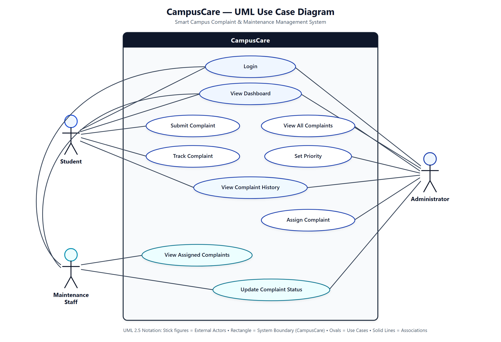
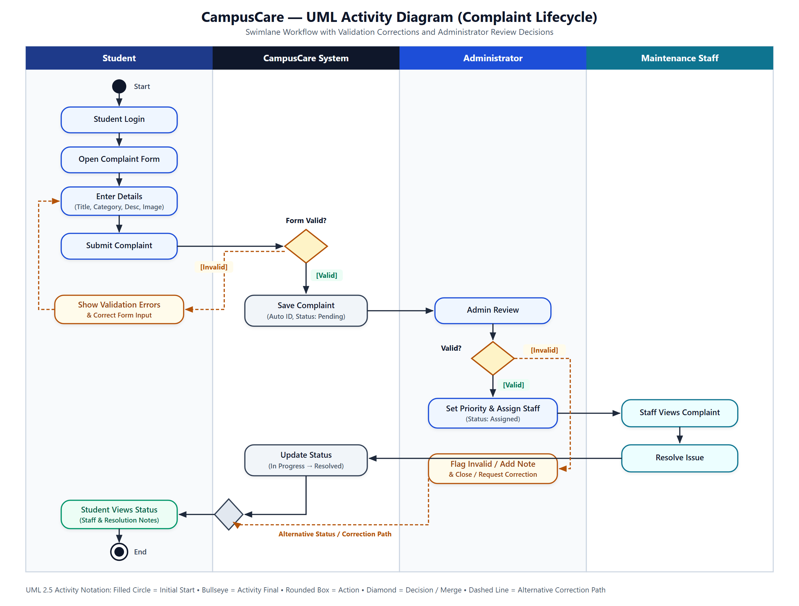
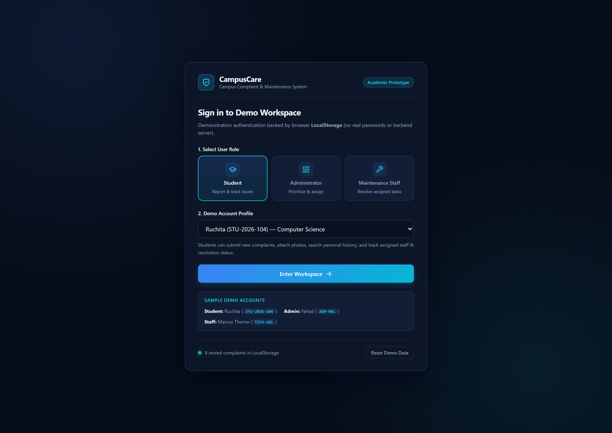
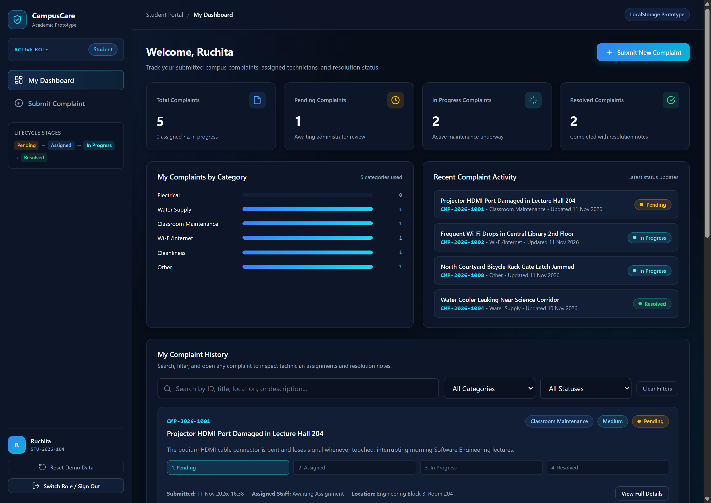
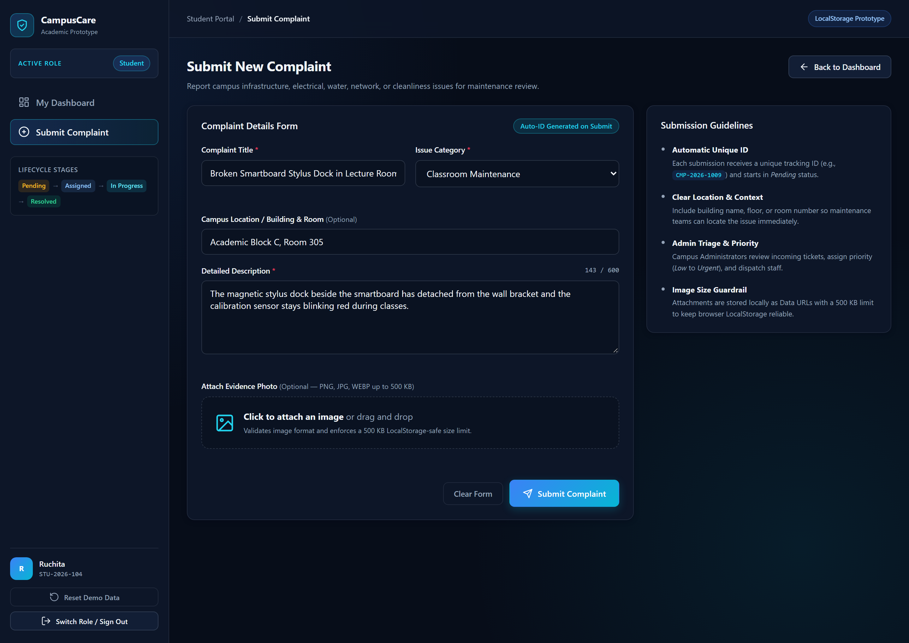
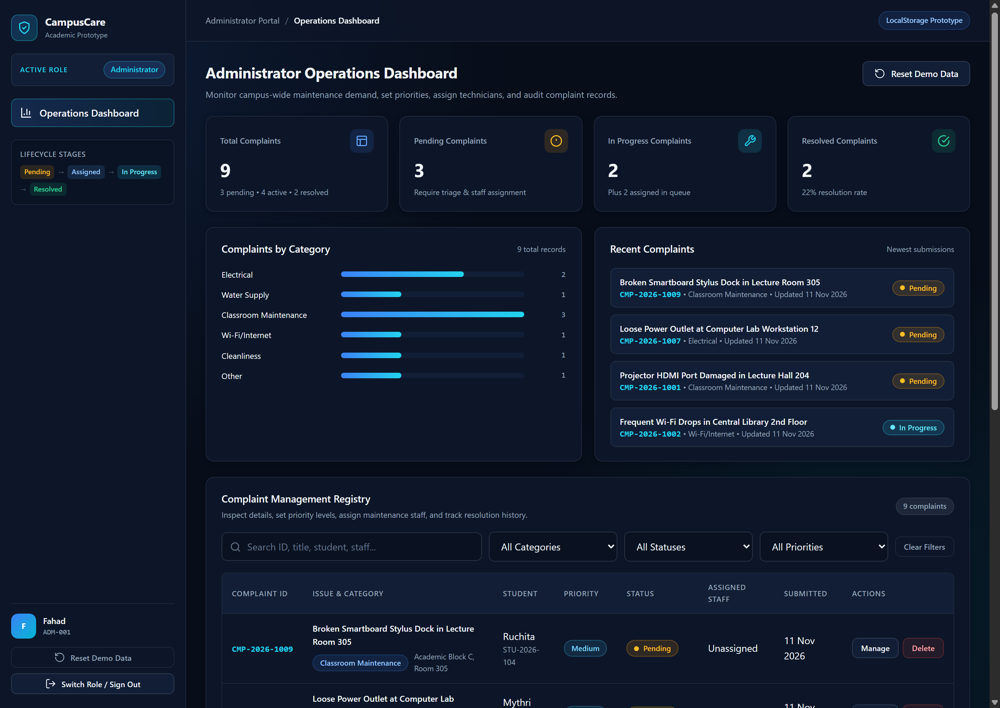
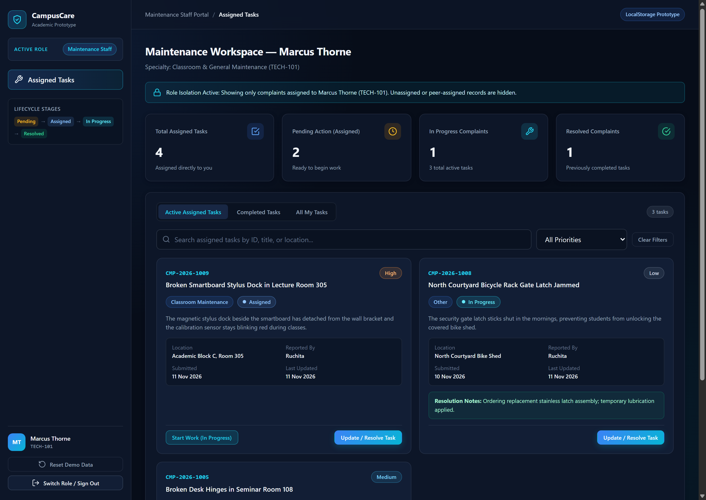

# CampusCare — Smart Campus Complaint & Maintenance Management System

---

## 1. Cover Page

| Field | Details |
| :--- | :--- |
| **Project Title** | **CampusCare – Smart Campus Complaint & Maintenance Management System** |
| **Assessment Type** | Software Design and Development Innovative Assessment (20 Marks) |
| **Course / Subject** | `[Course Code & Course Name]` |
| **Submitted By** | `[Student Name 1] ([Student ID 1])` `[Student Name 2] ([Student ID 2])` `[Student Name 3] ([Student ID 3])` *(remove if 2-member team)* |
| **Faculty Mentor / Instructor** | `[Faculty Name & Designation]` |
| **Department & Institution** | `[Department Name]`, `[Institution / University Name]` |
| **Submission Date** | `[Submission Date]` |
| **Prototype Classification** | Academic Functional Prototype (Client-Side HTML5 / CSS3 / Vanilla JS + `LocalStorage`) |

---

## 2. Abstract

Universities frequently rely on verbal reports, physical logbooks, or informal messaging channels to handle campus infrastructure complaints involving broken classroom equipment, electrical faults, water supply leaks, Wi-Fi disruptions, and sanitation concerns. These fragmented practices obscure ticket ownership, delay prioritization, and leave students without visibility into repair progress.

**CampusCare** is an academic functional prototype of a centralized, role-based web platform built with **HTML5, CSS3, Vanilla JavaScript, and browser `LocalStorage`**. It organizes campus maintenance operations across three user roles—**Student**, **Administrator**, and **Maintenance Staff**—and enforces a structured four-stage lifecycle: **`Pending → Assigned → In Progress → Resolved`**. Students submit validated complaints with optional image evidence and track live status updates; Administrators triage campus-wide demand, assign priorities (`Low` to `Urgent`), and dispatch technicians; Maintenance Staff manage exclusively their assigned tasks and record mandatory resolution notes upon completion. Automated end-to-end headless browser verification confirmed all five user interface screens, role isolation boundaries, input validation, cross-refresh `LocalStorage` persistence, and safe error recovery with zero console or runtime errors.

---

## 3. Introduction

Modern university campuses operate complex physical and digital infrastructure spanning lecture halls, laboratories, hostels, libraries, and utility networks. Timely maintenance directly affects instructional continuity, student safety, and institutional resource management. While large commercial enterprise service management platforms exist, their licensing costs, complex backend infrastructure, and deployment overhead make them impractical for rapid academic prototyping or lightweight demonstration.

CampusCare demonstrates core software engineering principles—requirements specification, UML behavioral and structural modeling, role-based access control, client-side state persistence, input sanitization, and responsive UI engineering—within a self-contained single-day prototype that opens directly in any standard web browser without external build tools or paid services.

---

## 4. Problem Statement

University facilities teams and students face four recurring challenges when campus issues are reported through ad-hoc or informal channels:

1. **Lack of Centralization:** Complaints raised verbally or across disconnected chat threads are easily lost or duplicated.
2. **No Accountability or Assignment Tracking:** Without formal assignment records, it is unclear which technician is responsible for a reported fault.
3. **Poor Prioritization:** Urgent safety hazards (such as loose power outlets or water leaks) cannot be systematically distinguished from routine requests.
4. **Absence of Status Transparency:** Students receive little or no feedback on whether an issue has been reviewed, assigned, started, or resolved.

CampusCare addresses these gaps by providing a single digital registry where every complaint receives a unique tracking ID, explicit priority, assigned technician ownership, timestamped audit history, and visible resolution notes.

---

## 5. Objectives

- **Improve Transparency:** Allow students to track their complaints continuously across `Pending`, `Assigned`, `In Progress`, and `Resolved` stages, including assigned staff details and final resolution notes.
- **Ensure Accountability:** Bind every assigned task to an explicit Maintenance Staff identifier and require written resolution notes before closure.
- **Organize Triage & Dispatch:** Equip Administrators with real-time counts, category breakdowns, search/filter controls, priority tags, and technician assignment controls.
- **Enforce Role Boundaries:** Restrict administrative triage exclusively to Administrators and isolate Maintenance Staff views strictly to complaints assigned to them.
- **Deliver Portable Reliability:** Persist demo records across browser refreshes via `LocalStorage` while validating all inputs, escaping rendered HTML, and handling storage anomalies gracefully.

---

## 6. Functional and Non-Functional Requirements

The complete specification (`documentation/requirements.md`) defines **7 Functional Requirements (`FR1–FR7`)** and **3 Non-Functional Requirements (`NFR1–NFR3`)**:

### Functional Requirements

- **FR1 — Role-Based Demo Authentication:** Provide a demonstration login portal supporting **Student**, **Administrator**, and **Maintenance Staff** role selection and fictional demo profiles without real passwords or backend verification, routing users directly to their role workspace.
- **FR2 — Validated Complaint Submission & Unique ID Generation:** Enable Students to submit complaints with required Title (min. 5 chars), Category (`Electrical`, `Water Supply`, `Classroom Maintenance`, `Wi-Fi/Internet`, `Cleanliness`, `Other`), optional Location, required Description (min. 15 chars, max. 600), and optional image attachment (`PNG`/`JPG`/`WEBP`, max. 500 KB), generating a unique sequential ID (`CMP-YYYY-XXXX`) in `Pending` status.
- **FR3 — Student Personal Dashboard & Tracking:** Display personal statistics (`Total`, `Pending`, `In Progress`, `Resolved`), category distribution, recent activity, searchable/filterable personal history, assigned technician info, and resolution notes.
- **FR4 — Administrator Triage, Prioritization & Assignment:** Display campus-wide KPIs, category distribution, recent complaints, and a filterable registry table where Administrators set Priority (`Low`, `Medium`, `High`, `Urgent`), assign Maintenance Staff, update status, and delete records after confirmation.
- **FR5 — Maintenance Staff Task Queue & Resolution Workflow:** Display assigned-only metrics and tabbed queues (**Active Assigned Tasks**, **Completed Tasks**, **All My Tasks**), allowing technicians to advance tasks (`Assigned → In Progress → Resolved`) with mandatory resolution notes (min. 8 chars).
- **FR6 — Role-Based Access & Data Isolation:** Enforce role permissions across navigation and actions, isolating Students to their own tickets and Maintenance Staff exclusively to tasks assigned to their ID.
- **FR7 — Persistent `LocalStorage` & Demo Data Reset:** Persist complaints, ID counters, and active demo sessions across browser reloads, and provide a confirmation-guarded **Reset Demo Data** action.

### Non-Functional Requirements

- **NFR1 — Client-Side Security & Data Integrity:** Escape all user-generated text before rendering into HTML, validate image MIME types and file size limits, and recover gracefully from missing, malformed, or quota-exceeded `LocalStorage` states.
- **NFR2 — Usability, Responsiveness & Accessibility:** Deliver a dark-navy SaaS interface (`#070D19`/`#0D1628`) with blue/cyan accents, desktop sidebar and mobile drawer layouts, clear status/priority indicators, empty states, toast notifications, and keyboard focus outlines.
- **NFR3 — Zero-Dependency Prototype Portability:** Operate purely on HTML5, CSS3, and Vanilla JavaScript without paid services, backend APIs, or build steps, remaining functional even if optional Google Fonts are unreachable offline.

---

## 7. System Design and Architecture

### 7.1 Client-Side Layered Architecture

Because CampusCare is an academic prototype running directly in the browser, it implements a clean three-layer modular architecture inside static files:

1. **Presentation Layer (`index.html`, `style.css`):** Declares five distinct views (`#screen-login`, `#screen-student-dashboard`, `#screen-submit-complaint`, `#screen-admin-dashboard`, `#screen-staff-dashboard`), shared detail/confirmation modals, toast notification container, and responsive dark-navy CSS variables.
2. **Application & Access Control Layer (`script.js`):**
   - **Router Guard (`canAccessScreen`, `navigateToScreen`):** Validates the active session role before displaying any view.
   - **Permission Guards:** Every read/write handler checks `state.session.role` and record ownership (`studentId` or `assignedStaffId`).
   - **Validation & Sanitization:** Validates form field lengths, image MIME/size limits, and escapes all interpolated user strings via `escapeHTML()`.
3. **Persistence Layer (`LocalStorage` Adapter):** Reads/writes JSON payloads under `campuscare_complaints_v1`, `campuscare_session_v1`, and `campuscare_counter_v1`, wrapped in `try/catch` blocks with schema sanitization (`sanitizeComplaint`) and automatic fallback to 8 fictional baseline complaints.

### 7.2 Complaint Data Model

Each complaint object stored in `campuscare_complaints_v1` contains:

- `id` *(String)*: Unique identifier (`CMP-2026-XXXX`)
- `studentId`, `studentName`, `studentCode`: Fictional student profile identifiers
- `title` *(String)*, `description` *(String)*, `category` *(Enum of 6)*, `location` *(String)*
- `imageData` *(Data URL or null)*, `imageName` *(String or null)*
- `createdAt`, `updatedAt` *(ISO-8601 timestamps)*
- `priority` *(`Low` | `Medium` | `High` | `Urgent`)*
- `status` *(`Pending` | `Assigned` | `In Progress` | `Resolved`)*
- `assignedStaffId`, `assignedStaffName` *(Nullable staff references)*
- `resolutionNotes` *(String)*
- `history` *(Array of timestamped `{ timestamp, actor, action, status }` audit entries)*

### 7.3 Role-Based Access Control Matrix

| Capability | Student | Administrator | Maintenance Staff |
| :--- | :---: | :---: | :---: |
| Demo Login & Role Workspace | Own Portal | Operations Portal | Technician Portal |
| Submit Validated Complaint | Yes | No | No |
| View Complaints | Own Only | All Campus Records | Assigned to Self Only |
| Set Priority & Assign Staff | No | Yes | No |
| Update Status (`In Progress` / `Resolved`) | No | Yes (Triage Override) | Assigned Tasks Only |
| Add Mandatory Resolution Notes | No | Optional Note | Required on Resolve |
| Delete Complaint Record | No | Yes (With Confirm) | No |

---

## 8. Use Case Diagram with Explanation

*Source file:* [`diagrams/use-case-diagram.svg`](../diagrams/use-case-diagram.svg)

### Diagram Explanation

Following UML 2.5 conventions, the diagram defines three external stick-figure actors interacting with the **`CampusCare`** system boundary across ten oval use cases:

1. **Student:** Authenticates via `Login`, views personal statistics on `View Dashboard`, creates tickets via `Submit Complaint`, monitors pipeline progress via `Track Complaint`, and reviews past audit entries in `View Complaint History`.
2. **Administrator:** Authenticates via `Login`, monitors campus metrics on `View Dashboard`, inspects all records via `View All Complaints` and `View Complaint History`, establishes urgency via `Set Priority`, dispatches technicians via `Assign Complaint`, and adjusts workflow stages via `Update Complaint Status`.
3. **Maintenance Staff:** Authenticates via `Login`, reviews personal workload on `View Dashboard`, accesses scoped assignments via `View Assigned Complaints`, and advances work (`In Progress` → `Resolved`) with notes via `Update Complaint Status`.

---

## 9. Activity Diagram with Explanation

*Source file:* [`diagrams/activity-diagram.svg`](../diagrams/activity-diagram.svg)

### Diagram Explanation

The UML Activity Diagram partitions responsibilities across four swimlanes (**Student**, **CampusCare System**, **Administrator**, **Maintenance Staff**) from the filled **Initial Node (`Start`)** to the bullseye **Activity Final Node (`End`)**:

1. **Submission & Form Validation Loop:** The Student logs in, opens the complaint form, enters details, and clicks Submit. The System evaluates **`Form Valid?`**: if `[Invalid]`, the alternative dashed path displays inline validation errors so the Student corrects input and re-enters details; if `[Valid]`, the System generates a unique ID (`CMP-YYYY-XXXX`) and saves the complaint as `Pending`.
2. **Administrator Review & Validity Decision:** The Administrator inspects the pending ticket and evaluates **`Valid?`**:
   - **`[Valid]` Path:** The Administrator sets priority and assigns a Maintenance Staff member (`Assigned`). The assigned technician views the complaint, resolves the physical/technical issue, and triggers `Update Status` (`In Progress → Resolved`) with resolution notes.
   - **`[Invalid]` Alternative Path:** If a ticket is duplicate, spam, or lacks actionable details, the Administrator flags it / records an explanatory admin note and closes or requests correction, merging back cleanly before status review.
3. **Closure:** Both paths converge at a UML Merge Diamond into **`Student Views Status`** and terminate at **`End`**.

---

## 10. UI Screen Designs with Explanation

*(Detailed rationale is also provided in [`documentation/ui-design-explanation.md`](ui-design-explanation.md).)*

### Screen 1: Role-Based Demo Login Portal

- **Purpose:** Provides a focused single-card portal featuring role selection (`Student`, `Administrator`, `Maintenance Staff`), demo profile dropdown, sample login instructions, explicit academic prototype disclaimer, and a quick **Reset Demo Data** action.

### Screen 2: Student Dashboard

- **Purpose:** Displays personal KPI cards (`Total`, `Pending`, `In Progress`, `Resolved`), category bars, recent activity, live search/category/status filters, and personal complaint cards featuring a visual 4-stage pipeline, assigned technician, and resolution notes.

### Screen 3: Complaint Submission Screen

- **Purpose:** Provides a validated multi-field form (`Title`, `Category`, `Location`, `Description` with live `0/600` character counter) and drag-and-drop optional photo uploader (`PNG`/`JPG`/`WEBP`, `500 KB` max) alongside clear submission guidelines.

### Screen 4: Administrator Operations Dashboard

- **Purpose:** Aggregates campus-wide statistics, dynamic category bars, newest complaints, multi-facet filters (`Search`, `Category`, `Status`, `Priority`), and the **Complaint Management Registry** table with `Manage` and confirmation-guarded `Delete` actions.

### Screen 5: Maintenance Staff Workspace

- **Purpose:** Enforces strict technician scope (`Role Isolation Active` banner), presents assigned workload KPIs, provides **Active Assigned Tasks** / **Completed Tasks** / **All My Tasks** tabs, and offers one-click `Start Work (In Progress)` plus mandatory-notes resolution updates.

---

## 11. Implementation and Technology Stack

- **HTML5 (`index.html`):** Semantic landmarks (`<main>`, `<aside>`, `<header>`, `<section>`), accessible ARIA labels, modal dialogs (`role="dialog"`), and `aria-live="polite"` toast notifications.
- **CSS3 (`style.css`):** Custom CSS property tokens (`#070D19` dark-navy canvas, `#0D1628` surfaces, `#3B82F6` blue & `#22D3EE` cyan accents), CSS Grid/Flexbox responsive breakpoints, and subtle transitions.
- **Vanilla JavaScript (`script.js`):** Encapsulated IIFE module (`use strict`) implementing seed data generation, safe `LocalStorage` persistence, sequential collision-free ID generation, role guards, HTML escaping (`escapeHTML`), and `FileReader` image validation.
- **Offline Resilience:** All icons are crisp inline SVGs; optional Google Fonts (`Inter`, `JetBrains Mono`) gracefully fall back to system UI and monospace stacks if offline.

---

## 12. Testing and Results

Automated end-to-end verification was executed against `index.html` using headless Google Chrome via Chrome DevTools Protocol (`--remote-debugging-pipe`), covering desktop (`1440px`) and mobile (`390px`) viewports alongside `LocalStorage` fault injection:

| Test ID | Test Scenario | Outcome |
| :---: | :--- | :---: |
| **T1** | Initial boot renders Login Screen and seeds 8 fictional baseline complaints | **PASS** |
| **T2** | Student login (`Ruchita`) isolates personal complaints and hides peer tickets | **PASS** |
| **T3** | Empty complaint submission triggers inline validation for Title, Category, Description | **PASS** |
| **T4** | Image attachment validator rejects non-image files (`text/plain`) and files `> 500 KB` | **PASS** |
| **T5** | Valid complaint submission generates unique ID `CMP-2026-1009` in `Pending` status | **PASS** |
| **T6** | Full page reload preserves active demo session and newly created `CMP-2026-1009` in `LocalStorage` | **PASS** |
| **T7** | Student live search & category/status filters narrow displayed complaints accurately | **PASS** |
| **T8** | Role access check prevents Student from inspecting another student's complaint modal | **PASS** |
| **T9** | Administrator views all 9 complaints, updates Priority to `High`, assigns `Marcus Thorne` (`Assigned`) | **PASS** |
| **T10** | Maintenance Staff (`Marcus Thorne`) views strictly his assigned tasks (excludes Sarah/unassigned) | **PASS** |
| **T11** | Staff advances `CMP-2026-1009` to `In Progress`; empty resolution note is blocked on Resolve | **PASS** |
| **T12** | Staff resolves `CMP-2026-1009` with resolution notes; Student view displays `Resolved`, technician & notes | **PASS** |
| **T13** | `` / `<script>` payloads are HTML-escaped on render (`window.__xssTriggered === false`) | **PASS** |
| **T14** | Destructive `Delete` and `Reset Demo Data` actions require confirmation modal before executing | **PASS** |
| **T15** | Mobile viewport (`390x844`) renders cleanly with zero horizontal overflow (`scrollWidth <= innerWidth`) | **PASS** |
| **T16** | Corrupted JSON in `LocalStorage` recovers automatically to valid 8-complaint baseline with 0 console/page errors | **PASS** |

---

## 13. Limitations

1. **Single-Browser `LocalStorage` Scope:** Data resides locally inside the user's browser and does not synchronize across devices or multi-user browsers.
2. **Demonstration Authentication:** Role selection simulates institutional access without password hashing, JWT/session cookies, or server-side authorization checks.
3. **Storage Quota Ceiling:** Browser `LocalStorage` (~5 MB per origin) restricts attachment size (`500 KB` limit per uploaded image) and high-volume archival storage.

---

## 14. Conclusion

CampusCare successfully fulfills all functional, security, architectural, and documentation goals of a centralized smart campus maintenance management prototype. By combining a clean, zero-dependency HTML5/CSS3/Vanilla JS implementation with formal UML Use Case and Activity models, strict client-side role isolation, and verified end-to-end persistence, the system provides a reliable, presentation-ready demonstration of software design and development principles.

---

## 15. Future Enhancements

1. **Backend REST API & Database Integration:** Migrate persistence from `LocalStorage` to a relational database (PostgreSQL/MySQL) with Node.js/FastAPI endpoints and cloud object storage for photo attachments.
2. **University SSO & Real RBAC:** Integrate institutional Single Sign-On (OAuth 2.0 / SAML) with cryptographically signed server-side role enforcement.
3. **Automated Notifications & SLA Escalation:** Dispatch email/SMS alerts on status transitions and automatically escalate overdue high-priority tickets.
4. **QR Code Room Tagging:** Enable students to scan classroom/lab QR stickers to auto-populate building and room metadata during submission.

